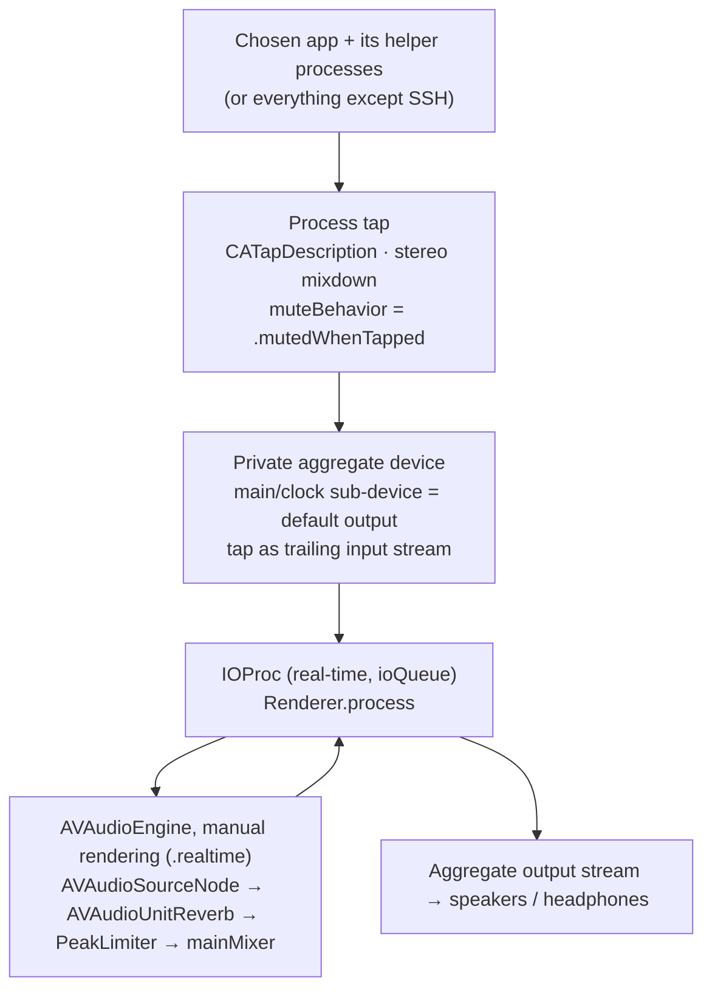
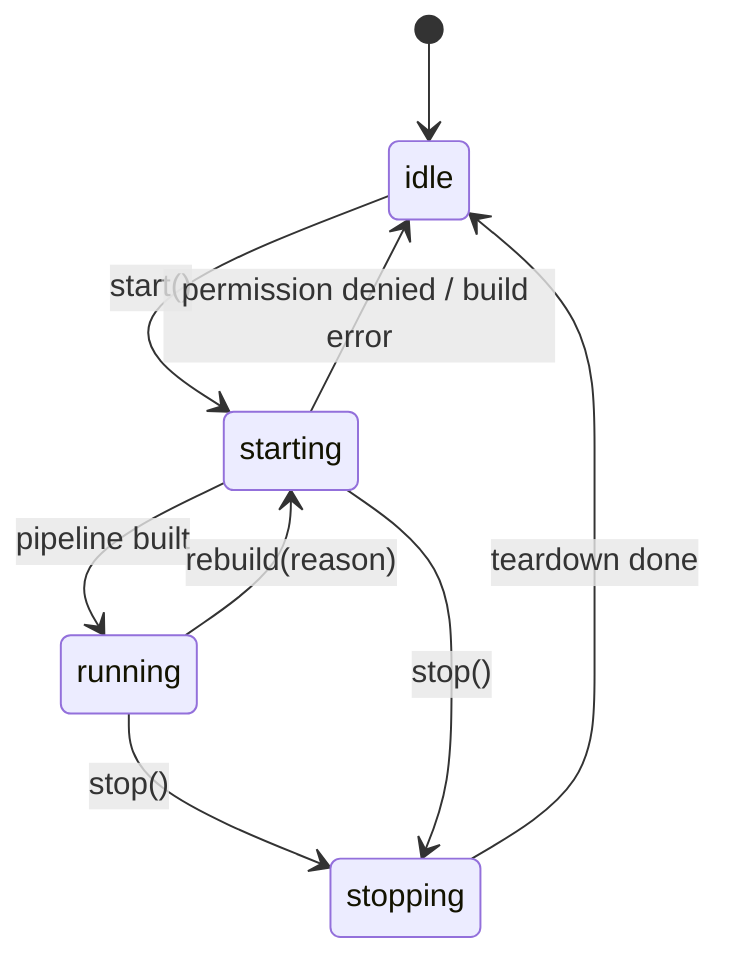
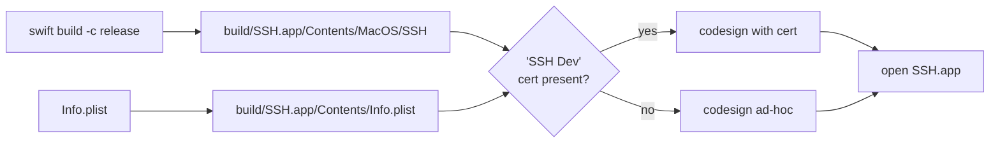

# SSH (Stadiums Self-Hosted) architecture

SSH version 0.2. This doc covers how the app captures another app's audio, adds reverb, plays it back, and recovers when the audio setup changes. For build and usage instructions, see the [README](../README.md).

## 1. Overview

The app has one SwiftUI process with three layers:

| Layer | Files | Responsibility |
| --- | --- | --- |
| UI | `SSHApp.swift`, `Views.swift` | Main window, menu bar panel, app lifecycle and signal handling |
| Control | `SSHController.swift` | Observable UI state, start/stop state machine, rebuild triggers, silence watchdog, saved settings |
| Audio | `AudioPipeline.swift`, `AudioSources.swift`, `CoreAudio.swift`, `SSHAtomics` (C) | Process tap, aggregate device, reverb engine, real-time callback, source discovery, permission check |

```mermaid
flowchart LR
    subgraph UI["UI (main thread)"]
        App[SSHApp<br/>AppDelegate]
        MW[MainWindow]
        MB[MenuBarPanel]
    end
    subgraph Control["Control"]
        C[SSHController<br/>@Observable]
    end
    subgraph Audio["Audio"]
        P[TapPipeline]
        R[Renderer]
        M[Meter]
        S[AudioSources]
        CA[CA helpers]
        TCC[AudioCapturePermission]
    end
    App --> C
    MW --> C
    MB --> C
    C -->|work queue| P
    C -->|scan queue| S
    C --> TCC
    P --> R
    R --> M
    MW -.->|reads peak at 20 Hz| M
    C -.->|watchdog reads| M
    P --> CA
    S --> CA
```

The only third-party code ideas come from FineTune, Mimir and AudioCap. They were reimplemented, not added as dependencies. All other frameworks are Apple system frameworks: SwiftUI, AppKit, AVFoundation, AudioToolbox, CoreAudio, Observation and os. The small `SSHAtomics` C target uses C11 `<stdatomic.h>`, because Swift's own atomics need macOS 15.

## 2. Signal path

Everything runs on **one clock and one real-time callback**. The real output device (speakers, AirPods and so on) drives the clock. The tap and the output share one private aggregate device, so there's no ring buffer between two separate devices and no drift between them.



What happens in each cycle of `Renderer.process`:

1. Zero all output buffers. Any early return gives silence, not garbage.
2. Take the **last** input buffer as the tap. Any earlier input buffers belong to the output device's own inputs, such as the AirPods mic, and are ignored.
3. Compute the peak level and update the `Meter`.
4. Find output channels 0 and 1. They can be in one interleaved buffer or in separate buffers (common on USB interfaces). A mono output gets an L+R downmix, and channels after the first two stay silent.
5. In chunks of up to 4096 frames: point the `SourceContext` at the tap samples, call the engine's `manualRenderingBlock`, and write the stereo result to those channels, hard-clipped to ±1 (NaN becomes 0).
6. If a render call fails, write the **dry** tap samples instead. The source is muted, so silence would mean the user hears nothing. After 100 failures in a row, the meter's `renderFailed` flag is set and the health check turns reverb off.

The `AVAudioEngine` runs in **manual rendering mode**, so it never opens hardware itself. The code never touches `engine.inputNode`, so the engine can't open a microphone.

## 3. Pipeline construction and teardown

`TapPipeline.start(spec:wetDryMix:preset:)` builds things in an order chosen so that **the source is muted only at the very last step**. If any earlier step fails, the source keeps playing as normal.


Notes on the aggregate device:

- It's **private** (`IsPrivate = true`), so it never shows up in Sound settings. It has a fresh UUID each time it's built.
- `TapAutoStart = true`.
- Drift compensation is off for the output sub-device. For the tap, it's on except when the output is Bluetooth. A Bluetooth tap and output share the same clock, and turning compensation on causes periodic crackle.
- `disableHardwareInputStreams` turns on only the trailing tap stream. If the headset mic were powered on, it would force Bluetooth into the low-quality hands-free profile and trigger a mic permission prompt.

`teardown()` is idempotent. It runs in reverse order: remove the device listeners, stop and destroy the IOProc (this un-mutes the source), destroy the aggregate device, destroy the tap, and stop the engine. It's also called from `deinit` and whenever `start` throws.

### What gets tapped (`TapSpec`)

| Selection | Spec | Tap description |
| --- | --- | --- |
| One app | `.processes(objects)` | `stereoMixdownOfProcesses:` with every Core Audio process object owned by that app |
| Everything | `.everythingExcept([own])` | `stereoGlobalTapButExcludeProcesses:` with SSH's own process object, which prevents feedback |

If SSH can't find its own process object, *Everything* refuses to start (`cannotExcludeSelf`) instead of creating a feedback loop.

## 4. Source discovery

Core Audio lists **processes**, not apps. `AudioSources.scan()` runs every 2 s on a utility queue:

1. Read `kAudioHardwarePropertyProcessObjectList` and get each object's PID and `IsRunningOutput` flag.
2. Map each PID to the `.app` that owns it, trying these in order:
   1. the process is itself a `.app`
   2. `responsibility_get_pid_responsible_for_pid` (private libsystem function, found with `dlsym`) returns a `.app`. This covers Safari and WebKit XPC services.
   3. walk the parent PIDs with `sysctl(KERN_PROC_PID)` until it reaches a `.app`. This covers Chrome-style helpers.
3. Group the process objects by the owning app's bundle ID, so several running copies of one app become one entry and are tapped together. The app counts as playing if any of its objects is playing.
4. Leave out SSH itself and anything without a bundle ID.
5. Sort playing apps first, then alphabetically.

The scan result is compared with the previous one, so SwiftUI only redraws when something changed.

## 5. Control layer

### State machine



`toggle()` and the UI switches do nothing while the state is `stopping`. While `starting` they stop, so you can cancel a start, for example while the permission prompt is open.

Every `start`, `stop` and `rebuild` increments a `generation` counter. The async completions (the permission answer, a finished or failed build) apply only if their generation is still the current one. If it isn't, a newer action owns the state and has already queued its own teardown or build on the serial work queue. Without this, answering the permission prompt after turning reverb off would still start it. If the user picks another source while a build is running, the finished build notices the change and rebuilds.

### Threading model

| Context | Used for |
| --- | --- |
| Main thread | All `@Observable` state, timers (scan 2 s, watchdog 0.5 s), NSWorkspace notifications, coalescing restarts |
| `SSH.control` (serial, userInitiated) | Every `TapPipeline` call: build, teardown, preset and mix changes. The UI never blocks on Core Audio. |
| `SSH.scan` (utility) | `AudioSources.scan()` |
| `SSH.system-listener` | Listener for default-output-device changes |
| `SSH.listener` (per pipeline) | Output sample-rate and device-alive listeners |
| `SSH.io` (userInteractive) | The IOProc. Real-time: no allocation, locks, logging or Objective-C calls. |

The real-time thread and the UI share state only through `Meter`: peak level, "signal seen" and "render failed". These are C11 relaxed atomics in `SSHAtomics`, so they need no locks and can't tear. The meter is reset on the work queue *after* the old pipeline's IOProc has stopped, so an old pipeline can't mark a new run as having signal.

`shutdownNow()` uses `work.sync`, so termination waits until teardown is finished and the source has been un-muted.

### Rebuild triggers

While the state is `running`, these events tear the pipeline down and build it again:

| Trigger | Detected by | Notes |
| --- | --- | --- |
| Default output device changed | HAL property listener on the system object | Collapsed with a 0.5 s debounce token. Skipped if the device ID didn't actually change. |
| Output sample rate changed | Listener inside `TapPipeline` | Common when Bluetooth switches between A2DP and hands-free |
| Selected app started a new audio process | Each 2 s scan compares process objects with `tappedObjects` | Chrome starts helpers at any time |
| User picked another source | `selectedSourceID.didSet` (or the build completion, if it changed while starting) | |
| Output device went away | `kAudioDevicePropertyDeviceIsAlive` listener inside `TapPipeline` | The aggregate is dead even if the device comes back with the same ID |
| Core Audio service restarted | `kAudioHardwarePropertyServiceRestarted` on the system object | Every old `AudioObjectID` is gone. The default-output listener is registered again, too |
| One copy of the selected app quit, another is still running | `NSWorkspace.didTerminateApplicationNotification` | Rebuild with the remaining copy's processes instead of stopping |

Preset and mix changes **don't** cause a rebuild. They're applied live to the `AVAudioUnitReverb` on the work queue.

### Automatic stops

- **Source quit.** An `NSWorkspace.didTerminateApplicationNotification` for the selected app stops the pipeline and shows a message.
- **Render failures.** If the engine has failed to render 100 times in a row (Renderer plays the dry signal meanwhile), the health check stops and says so.
- **Silence watchdog.** It checks every 0.5 s after start. If more than 3 s have passed, the source shows as playing, and the meter has never seen a non-zero sample, SSH stops so the source isn't left muted. It then shows the permission help. Once any signal has arrived, this check is skipped. The timer keeps running for the render-failure check.

### Persistence

Settings are stored in `UserDefaults` (standard suite). Saved values are validated on load. The mix is clamped to 0–100 and a non-number falls back to 35. The preset must be one of the five in `ReverbPresets.all`, because imported Objective-C enums accept any raw value.

| Key | Default |
| --- | --- |
| `selectedSource` | `com.apple.Music` (or `__everything__`) |
| `wetDryMix` | 35 |
| `reverbPreset` | `.largeHall` (shown as "Hall") |

## 6. App lifecycle and making sure the source is un-muted

The worst failure for this app is leaving the user's music muted. Several layers protect against that:

1. **Build order.** The source is muted only by the final `AudioDeviceStart` call.
2. **Normal quit.** `applicationWillTerminate` calls `shutdownNow()`.
3. **Signals.** SIGTERM, SIGINT and SIGHUP are set to ignore and handled with `DispatchSource` signal sources. The handler calls `shutdownNow()` and then `exit(0)`. `build.sh` relies on this when it uses `pkill -TERM` to stop a running copy before rebuilding.
4. **Watchdog** (section 5).
5. **Closing the window** doesn't quit the app (`applicationShouldTerminateAfterLastWindowClosed → false`). The menu bar extra keeps working.

SIGKILL and crashes skip all of the above. In those cases, cleanup depends on macOS removing the taps and aggregate device that belonged to the dead process.

## 7. Permissions and privacy

| Concern | How it's handled |
| --- | --- |
| System audio capture | TCC service `kTCCServiceAudioCapture`. Checked with `TCCAccessPreflight` and requested with `TCCAccessRequest`, both loaded with `dlopen` from the private `TCC.framework`. If the functions aren't available, the app falls back to the prompt macOS shows on first capture, and the watchdog catches a silent failure. |
| Prompt text | `NSAudioCaptureUsageDescription` in `Info.plist` |
| Microphone | Never captured. `NSMicrophoneUsageDescription` is there only as a fallback. Without it, macOS can terminate the app instead of asking when a headset exposes a mic on the same device. |
| Permission identity | Tied to the code signature. See the signing setup in the README. |
| Code injection | Signed with the hardened runtime (`--options runtime`), so `DYLD_INSERT_LIBRARIES` is ignored and only Apple-signed or same-team libraries load. Without it, any local process could inject code and use SSH's audio permission. The only entitlement is `com.apple.security.device.audio-input` (headset-mic case, still needs permission). |
| Logs | `os.Logger`. App names, device names and UIDs are logged `.private`, and everything else (states, counts, error codes) `.public`. |
| Settings deep link | `x-apple.systempreferences:com.apple.preference.security?Privacy_ScreenCapture` |

## 8. Build and packaging



- SwiftPM has one `executableTarget` plus the `SSHAtomics` C target, and no package dependencies. The minimum OS is macOS 14.2 (`Package.swift` and `LSMinimumSystemVersion`).
- `build.sh` builds the bundle by hand. There's no Xcode project, no asset catalog and no app icon.
- `codesign` runs with `--options runtime --entitlements SSH.entitlements`. A certificate named `SSH Dev` is used by its SHA-1 hash, and two certificates with that name stop the build with an explanation.
- Before rebuilding, `build.sh` sends SIGTERM to a running copy and waits up to 10 s for it to exit.
- The app is always started with `open`, so macOS gives the permission to SSH and not to the terminal.
- Bundle ID `com.yourname.stadiums-self-hosted` is a placeholder and appears in both `Info.plist` and `build.sh`.

## 9. Known risks and gaps

- **Private API use.** The TCC SPI and `responsibility_get_pid_responsible_for_pid` could change in any macOS release. The app is also not eligible for the App Store.
- **Tap format.** Only 32-bit float LPCM taps are accepted. Anything else fails with `unsupportedTapFormat`.
- **Output layout.** Only stereo is rendered: output channels 0 and 1, whether interleaved or in separate buffers. Mono outputs get a downmix, and further channels stay silent.
- **Granularity.** Taps work per process, so browser tabs can't be separated.
- **Polling.** Source discovery polls every 2 s instead of listening for HAL process-list changes.
- **No automated tests.** Most of the code depends on a live HAL. Good first candidates for tests are the helper-to-app mapping and `resolveSpec`.

## 10. Where to change things

| Change | Location |
| --- | --- |
| Add or rename a preset | `ReverbPresets.all` in `SSHController.swift` |
| Add an effect (EQ, delay, …) | `TapPipeline.buildEngine`: attach the node between `reverb` and `limiter` |
| Change rebuild or debounce timing | `scheduleRestart`, `startScanning` and `checkHealth` in the controller |
| New error message | `PipelineError` in `AudioPipeline.swift` |
| UI | `Views.swift` |
