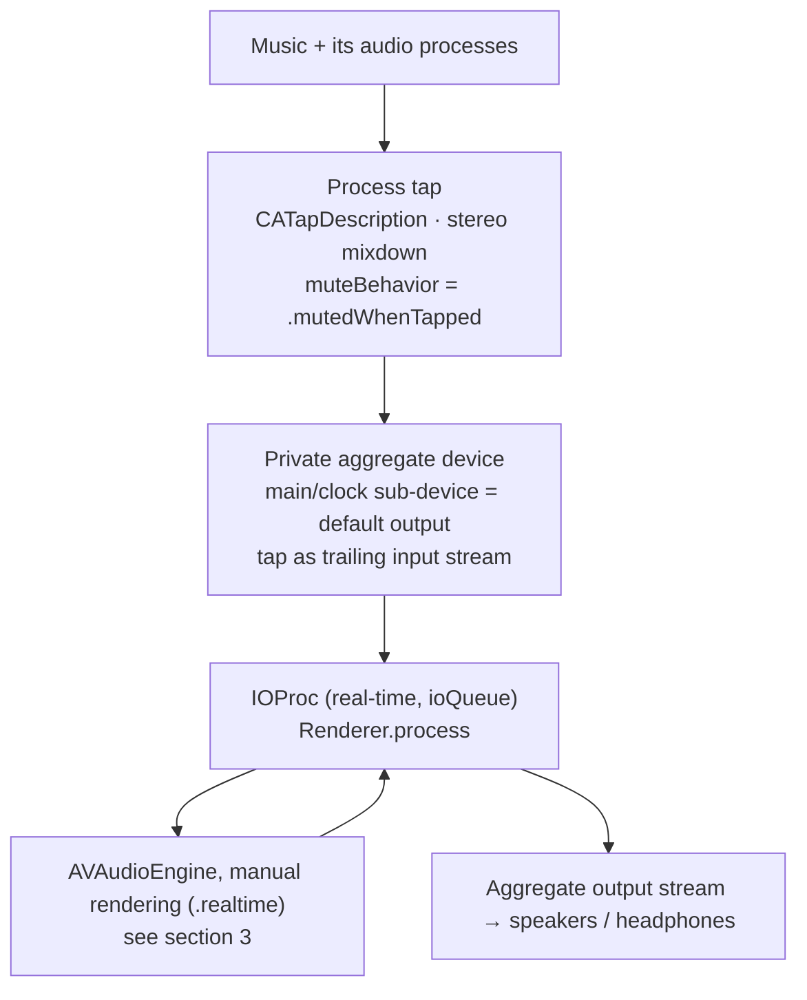
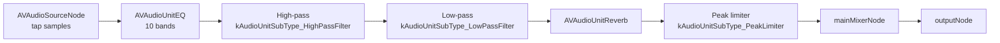
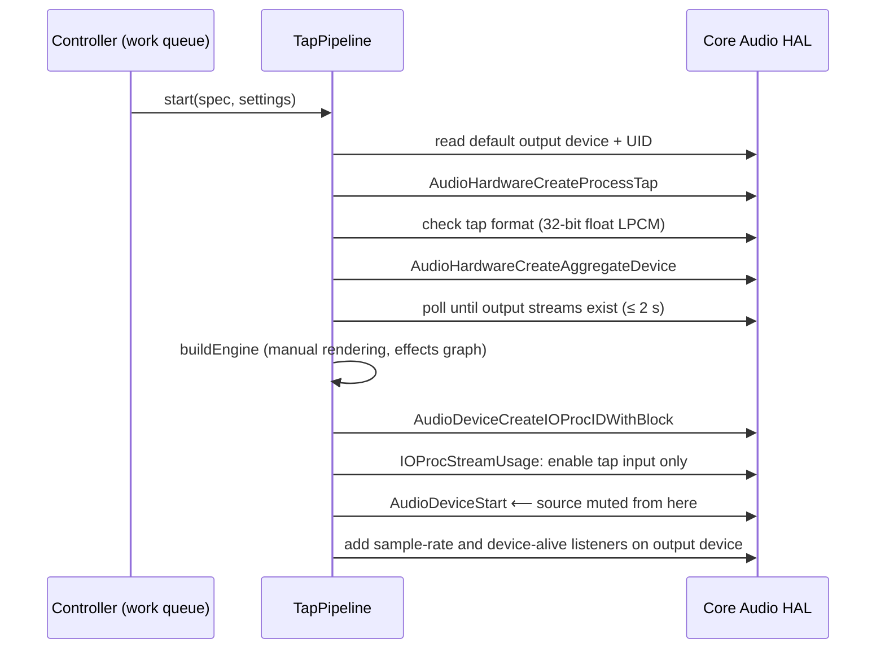
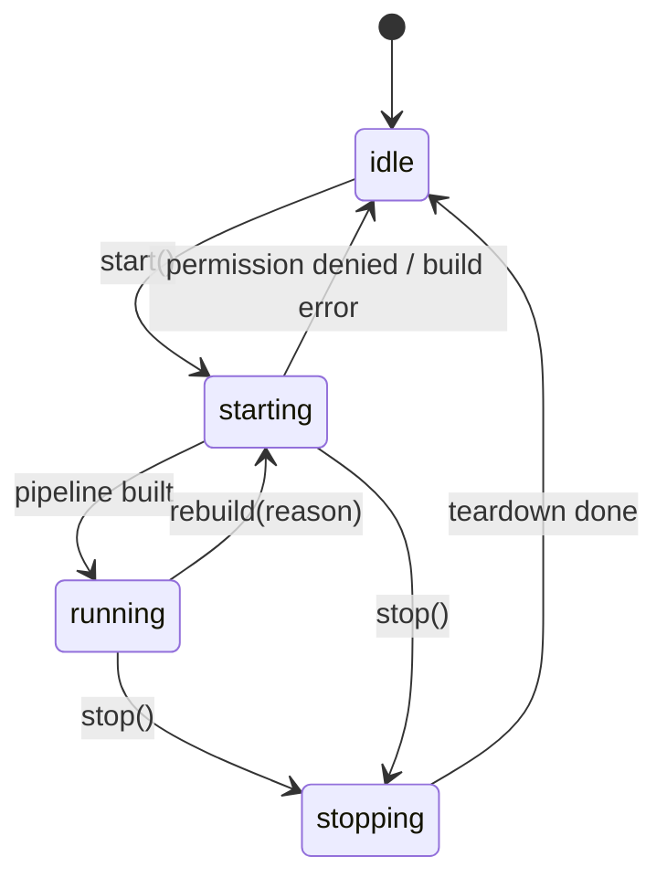
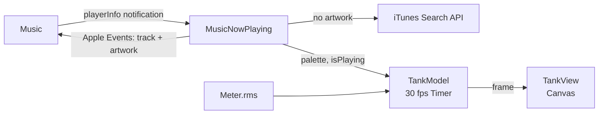
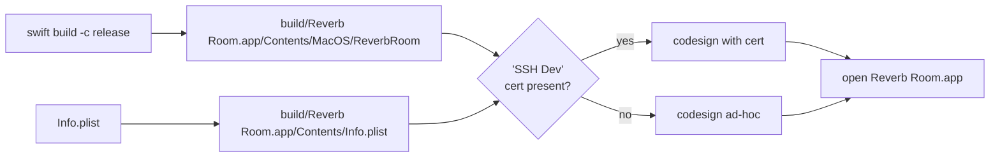

# Reverb Room architecture

Reverb Room version 0.2. This doc covers how the app captures another app's audio, runs it through the effects chain, plays it back, and recovers when the audio setup changes. For build and usage instructions, see the [README](../README.md).

The project was first called "Stadiums Self-Hosted" (SSH). The app, binary, bundle ID and log prefix are now Reverb Room, but the source folder (`Sources/SSH`), the Swift types (`SSHApp`, `SSHController`, `SSHAtomics`), the queue labels (`SSH.control`, …), the entitlements file and the `SSH Dev` certificate name still use the old prefix.

## 1. Overview

The app has one SwiftUI process with three layers:

| Layer | Files | Responsibility |
| --- | --- | --- |
| UI | `SSHApp.swift`, `Views.swift`, `Tank.swift` | Fixed-size main window, album-art tank, menu bar panel, app lifecycle and signal handling |
| Control | `SSHController.swift`, `MusicNowPlaying.swift`, `MusicEvents.swift` | Observable UI state, effect settings and presets, start/stop state machine, rebuild triggers, silence watchdog, saved settings; Music's current track, cover, playhead and player commands |
| Pure logic | `TankPalette.swift`, `LoudnessTone.swift`, `PlaybackClock.swift` | Cover colours, tone from loudness, the playhead between readings. Unit-tested |
| Audio | `AudioPipeline.swift`, `AudioSources.swift`, `CoreAudio.swift`, `SSHAtomics` (C) | Process tap, aggregate device, effects engine, real-time callback, source discovery, permission check, logging |

```mermaid
flowchart LR
    subgraph UI["UI (main thread)"]
        App[SSHApp<br/>AppDelegate]
        MW[MainWindow]
        MB[MenuBarPanel]
    end
    subgraph Control["Control"]
        C[SSHController<br/>@Observable]
    end
    subgraph Audio["Audio"]
        P[TapPipeline]
        R[Renderer]
        M[Meter]
        S[AudioSources]
        CA[CA helpers]
        TCC[AudioCapturePermission]
    end
    App --> C
    MW --> C
    MB --> C
    C -->|work queue| P
    C -->|scan queue| S
    C --> TCC
    P --> R
    R --> M
    MB -.->|reads peak at 20 Hz| M
    C -.->|watchdog reads| M
    P --> CA
    S --> CA
```

The only third-party code ideas come from FineTune, Mimir and AudioCap. They were reimplemented, not added as dependencies. All other frameworks are Apple system frameworks: SwiftUI, AppKit, AVFoundation, AudioToolbox, AudioUnit, CoreAudio, Observation and os. The small `SSHAtomics` C target uses C11 `<stdatomic.h>`, because Swift's own atomics need macOS 15.

## 2. Signal path

Everything runs on **one clock and one real-time callback**. The real output device (speakers, AirPods and so on) drives the clock. The tap and the output share one private aggregate device, so there's no ring buffer between two separate devices and no drift between them.



What happens in each cycle of `Renderer.process`:

1. Zero all output buffers. Any early return gives silence, not garbage.
2. Take the **last** input buffer as the tap. Any earlier input buffers belong to the output device's own inputs, such as the AirPods mic, and are ignored.
3. Compute the peak level and update the `Meter`.
4. Find output channels 0 and 1. They can be in one interleaved buffer or in separate buffers (common on USB interfaces). A mono output gets an L+R downmix, and channels after the first two stay silent.
5. In chunks of up to 4096 frames: point the `SourceContext` at the tap samples, call the engine's `manualRenderingBlock`, and write the stereo result to those channels, hard-clipped to ±1 (NaN becomes 0).
6. If a render call fails, write the **dry** tap samples instead. The source is muted, so silence would mean the user hears nothing. After 100 failures in a row, the meter's `renderFailed` flag is set and the health check turns the pipeline off.

The `AVAudioEngine` runs in **manual rendering mode**, so it never opens hardware itself. The code never touches `engine.inputNode`, so the engine can't open a microphone.

## 3. Effects chain

`TapPipeline.buildEngine(settings:)` builds this graph, all from Apple's built-in Audio Units:



The order is deliberate: shape the tone first (EQ), then cut the extremes (filter), then add the room last (reverb), so the reverb tail is built from the already-shaped signal. The limiter is a fixed safety stage, not a user control. It holds peaks near full scale before the hard clip in `Renderer`. Its decay is set to the unit's maximum, 60 ms. Apple's 24 ms default is shorter than one cycle of a 31 Hz bass note, so the limiter would change gain inside each cycle and distort the bass.

### EQ headroom (automatic preamp)

Music's EQ output stays in floating point until macOS applies the volume, so a boost past full scale is just turned down. Reverb Room limits and clips at full scale itself, so without headroom every boosted peak would hit the limiter and sound rough. To prevent that, `setEQGains` sets the EQ's `globalGain` to minus `EqualizerBands.peakBoost(gains:sampleRate:)`: the highest point of the combined curve, calculated by modelling each band as an RBJ peaking biquad and probing 241 log-spaced frequencies. Adjacent bands are an octave apart with 1-octave bandwidth, so they overlap. Bass Booster's highest slider is +5.5 dB, but its curve peaks at about +6.5 dB. Cut-only curves need no preamp.

| Module | UI | Node | Parameters | Default |
| --- | --- | --- | --- | --- |
| Equalizer | 10 vertical sliders + preset menu | `AVAudioUnitEQ(numberOfBands: 10)` | Bands at `EqualizerBands.frequencies` (31, 62, 125, 250, 500 Hz, 1, 2, 4, 8, 16 kHz). Each band `.parametric`, bandwidth 1 octave, gain −12…+12 dB | Off, flat |
| Filter | Low cut, High cut sliders | Two `AVAudioUnitEffect`s wrapping Apple's high-pass and low-pass units | `kHipassParam_CutoffFrequency` 20 Hz–2 kHz, `kLowPassParam_CutoffFrequency` 200 Hz–20 kHz | Off, 20 Hz / 20 kHz |
| Reverb | Space segmented control, Mix slider | `AVAudioUnitReverb` | `ReverbPresets.all` (Room, Chamber, Plate, Hall, Cathedral), `wetDryMix` 0–100% | On, Hall, 35% |

Every node stays in the graph for the life of the pipeline. A module's switch sets `kAudioUnitProperty_BypassEffect` on its unit (`setBypass(_:on:)`), and the Filter switch bypasses both of its units. This avoids changing the graph while the engine is rendering in real time. Parameter changes go through the per-effect setters on `TapPipeline` (`setEQGains`, `setLowPassCutoff`, `setPreset`, …), called on the work queue. Setting an Audio Unit property or parameter from outside the render thread is the standard host pattern; the unit synchronizes internally.

`EffectsSettings` bundles every effect value so a fresh pipeline starts with the current settings. After that, only the individual setters are used.

### EQ presets

`EqualizerPresets.all` in `SSHController.swift` holds Apple Music's 22 EQ presets as 10 gains each. Apple doesn't expose them through an API, so these are the published iTunes/Music values. Music's bands sit at 32 and 64 Hz where ours are at 31 and 62 Hz, which makes no audible difference.

The selected preset isn't stored. `eqPresetName` compares the current `eqGains` with every preset (within 0.01 dB) and returns the matching name, or "Custom". Moving any slider therefore switches the menu to Custom, and the selection survives relaunches through the saved gains. `applyEQPreset(named:)` sets all 10 gains and turns the EQ on, as Music does.

## 4. Pipeline construction and teardown

`TapPipeline.start(spec:settings:)` builds things in an order chosen so that **the source is muted only at the very last step**. If any earlier step fails, the source keeps playing as normal.



Notes on the aggregate device:

- It's **private** (`IsPrivate = true`), so it never shows up in Sound settings. It has a fresh UUID each time it's built.
- `TapAutoStart = true`.
- Drift compensation is off for the output sub-device. For the tap, it's on except when the output is Bluetooth. A Bluetooth tap and output share the same clock, and turning compensation on causes periodic crackle.
- `disableHardwareInputStreams` turns on only the trailing tap stream. If the headset mic were powered on, it would force Bluetooth into the low-quality hands-free profile and trigger a mic permission prompt.

`teardown()` is idempotent. It runs in reverse order: remove the device listeners, stop and destroy the IOProc (this un-mutes the source), destroy the aggregate device, destroy the tap, and stop the engine. It's also called from `deinit` and whenever `start` throws.

### What gets tapped

Music only. `TapPipeline.start(processes:settings:)` builds a `CATapDescription(stereoMixdownOfProcesses:)` from every Core Audio process object that belongs to Music, found by `SSHController.musicProcesses()`. Taps for other apps and the system-wide tap (which needed Reverb Room's own process excluded to avoid feedback) were removed on purpose.

## 5. Finding Music's processes

Core Audio lists **processes**, not apps. `AudioSources.scan()` runs every 2 s on a utility queue:

1. Read `kAudioHardwarePropertyProcessObjectList` and get each object's PID and `IsRunningOutput` flag.
2. Map each PID to the `.app` that owns it, trying these in order:
   1. the process is itself a `.app`
   2. `responsibility_get_pid_responsible_for_pid` (private libsystem function, found with `dlsym`) returns a `.app`. This covers Safari and WebKit XPC services.
   3. walk the parent PIDs with `sysctl(KERN_PROC_PID)` until it reaches a `.app`. This covers Chrome-style helpers.
3. Group the process objects by the owning app's bundle ID, so several running copies of one app become one entry and are tapped together. The app counts as playing if any of its objects is playing.
4. Leave out Reverb Room itself and anything without a bundle ID.

The controller keeps the entry whose bundle ID is `com.apple.Music`. Its `isPlaying` flag feeds the silence watchdog, and its process list is compared with the tapped processes to decide whether to rebuild. The mapping steps for helper processes were written for browsers; Music may not need them, but they stay as the working path.

## 6. Control layer

### State machine



`toggle()` and the UI switches do nothing while the state is `stopping`. While `starting` they stop, so you can cancel a start, for example while the permission prompt is open.

Every `start`, `stop` and `rebuild` increments a `generation` counter. The async completions (the permission answer, a finished or failed build) apply only if their generation is still the current one. If it isn't, a newer action owns the state and has already queued its own teardown or build on the serial work queue. Without this, answering the permission prompt after switching off would still start the pipeline. If the user picks another source while a build is running, the finished build notices the change and rebuilds.

### Threading model

| Context | Used for |
| --- | --- |
| Main thread | All `@Observable` state, timers (scan 2 s, watchdog 0.5 s, tank 30 fps, playhead 0.5 s while playing), NSWorkspace and Music notifications, coalescing restarts |
| `SSH.music` (serial, user-initiated) | Every Apple Event to Music (`MusicEvents`: track, cover, playback reads and player commands), plus decoding the cover and picking its colours. Results are applied on the main thread |
| Global utility queue | The Automation permission check (it blocks until the user answers the prompt) |
| URLSession | The online cover lookup and download |
| `SSH.control` (serial, userInitiated) | Every `TapPipeline` call: build, teardown and every effect setting change. The UI never blocks on Core Audio. |
| `SSH.scan` (utility) | `AudioSources.scan()` |
| `SSH.system-listener` | Listener for default-output-device changes |
| `SSH.listener` (per pipeline) | Output sample-rate and device-alive listeners |
| `SSH.io` (userInteractive) | The IOProc. Real-time: no allocation, locks, logging or Objective-C calls. |

The real-time thread and the UI share state only through `Meter`: peak level, RMS, "signal seen" and "render failed". These are C11 relaxed atomics in `SSHAtomics`, so they need no locks and can't tear. The menu bar panel's level meter reads the peak at 20 Hz, and the tank reads the RMS at 30 fps. The meter is reset on the work queue *after* the old pipeline's IOProc has stopped, so an old pipeline can't mark a new run as having signal.

`shutdownNow()` uses `work.sync`, so termination waits until teardown is finished and the source has been un-muted.

### Rebuild triggers

While the state is `running`, these events tear the pipeline down and build it again:

| Trigger | Detected by | Notes |
| --- | --- | --- |
| Default output device changed | HAL property listener on the system object | Collapsed with a 0.5 s debounce token. Skipped if the device ID didn't actually change. |
| Output sample rate changed | Listener inside `TapPipeline` | Common when Bluetooth switches between A2DP and hands-free |
| Music started a new audio process | Each 2 s scan compares process objects with `tappedObjects` | |
| Output device went away | `kAudioDevicePropertyDeviceIsAlive` listener inside `TapPipeline` | The aggregate is dead even if the device comes back with the same ID |
| Core Audio service restarted | `kAudioHardwarePropertyServiceRestarted` on the system object | Every old `AudioObjectID` is gone. The default-output listener is registered again, too |
| One copy of Music quit, another is still running | `NSWorkspace.didTerminateApplicationNotification` | Rebuild with the remaining copy's processes instead of stopping |

Effect changes (switches, sliders, presets) **don't** cause a rebuild. They're applied live through the `TapPipeline` setters on the work queue (section 3).

### Automatic stops

- **Music quit.** An `NSWorkspace.didTerminateApplicationNotification` for Music stops the pipeline and shows a message.
- **Render failures.** If the engine has failed to render 100 times in a row (Renderer plays the dry signal meanwhile), the health check stops and says so.
- **Silence watchdog.** It checks every 0.5 s after start. If more than 3 s have passed, the source shows as playing, and the meter has never seen a non-zero sample, Reverb Room stops so the source isn't left muted. It then shows the permission help. Once any signal has arrived, this check is skipped. The timer keeps running for the render-failure check.

### Persistence

Settings are stored in `UserDefaults` (standard suite) and written from each property's `didSet`. Saved values are validated on load, because a hand-edited preference could otherwise reach an Audio Unit:

- Numbers are clamped to their control's range and fall back to the default if they're missing or not a number (`savedFloat`, and `savedMix` for the reverb mix).
- The reverb preset must be one of the five in `ReverbPresets.all`, because imported Objective-C enums accept any raw value.
- `eqGains` must be exactly 10 numbers. Each is clamped to ±12 dB. Anything else falls back to flat.

| Key | Default |
| --- | --- |
| `reverbEnabled` | `true` |
| `reverbPreset` | `.largeHall` (shown as "Hall") |
| `wetDryMix` | 35 |
| `filterEnabled` | `false` |
| `highPassCutoff` | 20 (Hz) |
| `lowPassCutoff` | 20000 (Hz) |
| `eqEnabled` | `false` |
| `eqGains` | ten zeros (flat) |
| `tankFocus` | 0.5 (stored by `TankModel`, clamped to 0–1) |
| `tankSpeed` | 1 (stored by `TankModel`, clamped to 0.2–3) |
| `tankMode` | `bokeh` (unknown values, including the removed `blobs`, `shapes` and `comet`, fall back to it) |

Older builds also saved `selectedSource`, and development builds wrote keys for effects that were later removed (`compressor*`, `delay*`, `murker*`). Nothing reads them anymore.

## 7. App lifecycle and making sure the source is un-muted

The worst failure for this app is leaving the user's music muted. Several layers protect against that:

1. **Build order.** The source is muted only by the final `AudioDeviceStart` call.
2. **Normal quit.** `applicationWillTerminate` calls `shutdownNow()`.
3. **Signals.** SIGTERM, SIGINT and SIGHUP are set to ignore and handled with `DispatchSource` signal sources. The handler calls `shutdownNow()` and then `exit(0)`. `build.sh` relies on this when it uses `pkill -TERM` to stop a running copy before rebuilding.
4. **Watchdog** (section 6).
5. **Closing the window** doesn't quit the app (`applicationShouldTerminateAfterLastWindowClosed → false`). The menu bar extra keeps working.

SIGKILL and crashes skip all of the above. In those cases, cleanup depends on macOS removing the taps and aggregate device that belonged to the dead process.

## 8. Album-art tank

The whole main window, behind the panel: by default six soft blobs (the Bokeh style) in the current song's three cover colours (one per band), drifting over dark water, lighter in the song's loud passages and darker in its quiet ones. The full design and the reasons are in [album-tank-plan.md](album-tank-plan.md).



### Following Music (`MusicNowPlaying`)

- **Track changes and play/pause** come from Music's `com.apple.Music.playerInfo` distributed notification, which needs no permission.
- **The artwork** comes from Apple Events sent by `MusicEvents.track()` on the `SSH.music` queue: player state, then the current track's name, artist, album and `raw data` (falling back to `data`) of its first artwork, each read guarded. It runs at launch if Music is open, and again whenever the notification reports a different track.
- **Music is never scripted unless it's already running**, because `tell application "Music"` launches it.
- **Permission.** Scripting needs Automation approval. The prompt is raised with `AEDeterminePermissionToAutomateTarget` on a utility queue, because the first Apple Event would otherwise block the main thread until the user answers. If it's denied, the tank uses `TankPalette.neutral` and the footer offers **Open Automation Settings…**. The effects never depend on any of this.
- **Playback.** A second script reads the player state, position, duration, shuffle and `song repeat`. It runs after each track read, after each player command, after a play/pause notification, and every 5 s while playing, which also catches seeks and skips made in Music itself. In between, `PlaybackClock` counts forward from the last reading on a 0.5 s timer (`now`), so the playhead moves smoothly without scripting Music every tick. The notification also carries the title, artist, album and length, so the panel names the song even without Automation approval.
- **Player commands.** `playPause`, `previous` (Music's `back track`: restart, or go back if the song just started), `next`, `seek(to:)`, `toggleShuffle` and `cycleRepeat` (off → all → one, Music's order) each send one Apple Event (`hook`/`PlPs`, `Next`, `Back`, or `core`/`setd` on `player position`, `shuffle enabled`, `song repeat`), then re-read playback. Play/pause, shuffle and repeat update the UI first so the buttons respond instantly, and that value is held for 2 s against re-reads, because Music can briefly report the old value; shuffle and repeat skip the immediate re-read altogether. Nothing waits on Music on the main thread. These used to be `NSAppleScript`s, which may only run on the main thread, and each took 40–80 ms: a dropped-frame hitch on every 5 s playhead resync and about 90 ms per button press. Raw Apple Events (`NSAppleEventDescriptor.sendEvent`) are safe on any thread, so they all go through one serial queue, in order. The four-character codes come from `Music.app/Contents/Resources/com.apple.Music.sdef`. Commands are ignored unless Automation is granted and Music is running; with permission not yet decided, a tap asks for it.
- **Online fallback (`CoverSearch.swift`).** If Music returns no artwork (often the case for streamed catalogue songs; Music then returns `missing value`, a `'msng'` type descriptor, which is skipped rather than decoded), the cover is looked up in Apple's public iTunes Search API. Queries run in order until one gives a believable match: for the Mac's region's store, then the US store, an album search, then a song search. The API defaults to the US store, where many non-US artists aren't listed at all, so the region matters. A result counts only if its artist and its album or song title match (ignoring case, accents and character width), exact matches winning. Results, including "not found", are cached per album or single for the session. A failed script keeps the previous palette.
- **Mid-change reads.** If Music answers the track script before the new song is ready (no name, artist or album), it's asked again up to 3 times, a second apart, instead of dropping the cover.

### Colours (`TankPalette.swift`)

The cover is shrunk to 32 × 32 sRGB pixels and grouped into 6 clusters with a k-means seeded from luminance quantiles, so the same cover always gives the same result (about 0.16 ms in a release build). The three picks are the clusters with the largest share weighted towards vivid ones (`share × (0.35 + chroma)`), each differing visibly from the ones before it. Near-grey clusters are skipped unless the whole cover is grey, and clusters under 3% are ignored. A cover with fewer distinct colours is filled out with a darker (55%) or paler (45% towards white) shade of a colour already picked, whichever is furthest from all the picks. The water is the darkest pick mixed 84% towards black.

The bands take the colours in order (`TankPalette.color(for:)`: bass first, song second, treble third), but `TankModel` shuffles the palette (`reordered`) each time Music reports a new one, so the pairing differs from song to song. It remembers the unshuffled palette it was given, so the shuffle happens once per change and not on every tick.

**Window tint (`AmbientTint`).** The window background is a vertical gradient of one colour at 16% over 6% opacity on the normal window background. The colour moves through the palette's three colours, one cycle every 45 s with smoothstep easing, after lifting each to at least 80% brightness. `TankModel.tint` is updated every sixth tick (5 Hz), and only `AmbientBackground` reads it, so a tint change redraws only the background. Very dark cover colours are lifted before toning so the blobs stay visible.

### Loudness to tone (`LoudnessTone.swift`)

The audio thread adds each cycle's mean square to a short exponential average (about 50 ms) in `SSHAtomics`, and `Meter.rms` exposes its square root. Everything else runs in the tank's timer:

- The level in dBFS is compared with its running average. The difference, capped at a range, maps to a target tone from 0 to 1, with 0.5 for "usual". The tone follows the target with separate rise and fall times. Two presets: `.song` (12 s average, ±5 dB, 0.15 s rise, 0.8 s fall: pulses with the music without flickering) for the overall level, and `.hits` (below) for the bass and treble bands.
- Below −60 dBFS counts as silence (a gap between songs) and doesn't move the average.
- **Effects off:** there's no audio reading, so the tone rests at 0.5 and the average is forgotten. **Music paused or stopped:** the tone dims to 0.1 and the drift slows to 35%. "Playing" is Music's notified state, or audible RMS while the effects run, so a denied Automation permission doesn't leave the tank dimmed.
- The tone drives three things (`TankTone`): colour (`blobColor`: 25% brightness at 0, full at 1, with up to 30% lift towards white above 0.7), size (`radiusScale`: 85% to 120% of each blob's size) and glow (`opacity`: 0.7× to 1.3× each blob's opacity, capped at fully opaque).

### Bass and treble (`BandSplitter.swift`, `HitDetector.swift`)

Besides the overall RMS, the audio thread splits each cycle's tapped audio (mixed to mono) into two bands, each two second-order filters in series (24 dB/octave): a low-pass at 120 Hz for the **bass** (kick drums) and a high-pass at 7 kHz for the **treble** (hi-hats, cymbals). That's four filter stages per sample, allocation-free, with filter state kept in `Renderer`. Each band's mean square goes into `SSHAtomics` as a fast-decaying peak (70% kept per cycle, so a hit fades within about 70 ms) rather than an average, so a drum hit between two 30 fps UI reads is still seen. `Meter.bassRMS` and `Meter.trebleRMS` read them.

Each band feeds two things in `TankModel`:

- A `LoudnessTone` with the `.hits` response (2.5 s average, ±6 dB): the band's general level, which only sets how dim its blobs rest between hits (`TankTone.hitRestTone`, 0.2–0.5).
- A `HitDetector`: a pulse when the band jumps more than 2.5 dB above its recent level (0.35 s average for bass, 0.2 s for treble), 0.5–1 by the size of the jump. The pulse eases up to that over `attackSeconds` (0.06 s kicks, 0.03 s hats) so blobs don't snap, holds for that long, then decays over 0.22 s (kicks) or 0.08 s (hats). A 0.12 s / 0.06 s hold-off stops one hit firing twice. A steady level, however loud, gives no pulse.

When drawing, a bass or treble blob's tone is `TankTone.hitTone(level:hit:)`: the resting tone, lifted by the pulse to `TankTone.hitPeakTone` (0.85: bright with a little white, not the full flash). The pulse also swells the blob (`TankBand.hitSwell`: +15% bass, +10% treble). Song blobs keep the `.song` response and no hits. Each band has its own colour (see Colours above).

### Drawing (`Tank.swift`)

`TankModel` is advanced by a 30 fps main-thread `Timer` and publishes one `Frame` (time, tone, palette) per tick. `TankView` reads the frame in `body`, so each tick is one tracked change, and draws it in a `Canvas`: the water, then the blobs as radial gradients with screen blending (all in one layer), then a vignette and a glass highlight. It's edge to edge, with no rim. Blob positions come from `TankBlobs.layout(time:in:)`, a pure function of time (looping paths of 30–60 s, different per axis and per blob), so there's no animation state. Blob sizes scale with half the geometric mean of the tank's sides, so they keep the same share of the tank whatever its shape.

**Focus.** The slider in the panel's Visualizer section sets `TankModel.focus` (0 hazy … 1 sharp; `TankFocus`). The scene layer is blurred by `maxBlur` (12% of the tank scale) × (1 − focus) × the style's `TankMode.blurAmount` (bokeh 0.4, drops 0.6, rain 0.28, so each looks about as hazy at the same slider position; since thin lines vanish under a big blur), so every step of the slider changes every style and only 1 is fully sharp. In the sharp half (above the 0.5 default), blobs also keep a solid core of up to 90% of their radius.

**Styles (`TankMode`, `TankScenes.swift`, `TankMotion.swift`).** `TankView` draws the water, then one layer (blurred for Focus, screen-blended onto the water) that `TankScenes.draw` fills for the chosen style, then the vignette and glass. Every style uses the same band colours and `BandLook` (tone, size and hit per band), and all but Rain are pure functions of the frame's time:

| Style | What's drawn | Music |
| --- | --- | --- |
| Bokeh | 18 radial-gradient discs (`TankBlobs.bokehLayout`: three copies of the six blob paths, shifted 0 / 23.7 / 47.3 s and mirrored left–right or top–bottom) at a quarter of the blob radius (`TankScenes.bokehSize`), solid for the inner half (`bokehSolid`, widening with sharper focus) before a short fade | Song: loudness; bass/treble: hits |
| Water drops | `DropShape.circles` per blob at 0.52 of its radius (core, 4 orbiting lobes, a satellite droplet); each band's circles go through `blur` then `alphaThreshold(0.5)` so they merge like liquid. No highlight (a glint was tried and read as a stray oval) | Kicks throw lobes outward |
| Rain | `Ripple.rings` for each ripple in `Frame.ripples` | Song loudness sets the drop rate; kicks land big drops, hats small ones |

Rain is the one stateful style: `RainField` (in the model, updated only while Rain is shown) lands drops as the rate adds up and when `HitDetector.count` goes up, and drops ripples after 2.6 s, capped at 48. "Random" wobbles and positions come from `tankHash` (SplitMix64 of an index), so a redraw of the same moment looks the same.

**Speed.** `TankModel.speed` (0.2×–3×) multiplies how fast the frame's time advances, so the paths stay the same and changing speed never makes the blobs jump.

The timer does no work while the window is closed, minimised or fully covered (`NSWindow.occlusionState`). A covered window draws nothing. `TimelineView` is deliberately not used: an earlier waveform visualizer built on it never redrew, and the cause was never found.

On a track change the palette cross-fades over 2 s. The fade only advances while the tank is on screen.

## 9. UI

The main window (`MainWindow` in `Views.swift`) opens at 976 × 800 pt and can grow from there (`.frame(minWidth:minHeight:)` and `.windowResizability(.contentMinSize)` in `SSHApp.swift`), including full screen. The tank fills it. The controls are a floating panel (fixed 540 pt wide, so its labels never reflow or wrap mid-word), inset 16 pt from the window edges: a rounded rectangle of 94% opaque window colour with the cover-colour wash (not a blurring material, which re-blurred the moving tank every frame), a hairline border and a shadow cast by a plain shape. A glass chevron tab to its left (⌃⌘S) slides it in and out; whether it's shown is saved as `sidebarShown`. While it's hidden, `NowPlayingHero` shows Music's full-screen look in the bottom-left corner of the tank: the cover (up to 300 pt) with the track name in 34 pt bold and the artist in 20 pt beside it. The two take turns rather than overlapping: hiding slides the panel out, then 0.25 s later fades the player up 40 pt into place; showing fades the player down and out, then slides the panel back in (`heroShown` trails `sidebarShown`). The panel's player and effects scroll if the window is short; the Visualizer section stays pinned at its bottom.

| Area | Contents |
| --- | --- |
| Tank (whole window) | `TankView` (section 8) |
| Panel background | `AmbientBackground`: the cover-colour wash on a translucent window-colour fill (section 8) |
| Now Playing (panel, top) | `NowPlayingView`: 56 pt cover, "Now Playing", "Artist – Track", playhead `Slider` with elapsed and remaining time, and `PlayerButton`s (shuffle, previous, play/pause, next, repeat). While the playhead is dragged, the timer doesn't move it; releasing seeks |
| Transport bar (panel) | Status title and subtitle, main on/off switch |
| Effects rack (panel) | `EffectModuleBox`es stacked vertically: Filter, Reverb, Equalizer. Each has a name, its own switch, and its controls, always expanded |
| Footer (panel, under the effects) | `ErrorBox`; or the audio permission status and **Open Privacy Settings…** while access isn't granted; or the Automation hint with **Open Automation Settings…** when reading Music is denied. Takes no space otherwise |
| Visualizer (panel, pinned at the bottom) |
| Full-screen player (panel hidden) | `NowPlayingHero`: cover, track name, artist | Style picker and the Focus and Speed `TankSlider`s |

Shared pieces: `ValueSlider` (horizontal slider with a live readout), `EQBandSlider` (a vertical fader, made by rotating a `Slider` because SwiftUI has no vertical one), and `Font.display(_:weight:)`, which sets headers and titles in Helvetica Neue while body text stays in the system font.

The menu bar panel (`MenuBarPanel`) has the on/off switch, the level meter while running, any error, and the reverb mix slider.

## 10. Permissions and privacy

| Concern | How it's handled |
| --- | --- |
| System audio capture | TCC service `kTCCServiceAudioCapture`. Checked with `TCCAccessPreflight` and requested with `TCCAccessRequest`, both loaded with `dlopen` from the private `TCC.framework`. If the functions aren't available, the app falls back to the prompt macOS shows on first capture, and the watchdog catches a silent failure. |
| Prompt text | `NSAudioCaptureUsageDescription` in `Info.plist` |
| Microphone | Never captured. `NSMicrophoneUsageDescription` is there only as a fallback. Without it, macOS can terminate the app instead of asking when a headset exposes a mic on the same device. |
| Permission identity | Tied to the code signature. See the signing setup in the README. |
| Code injection | Signed with the hardened runtime (`--options runtime`), so `DYLD_INSERT_LIBRARIES` is ignored and only Apple-signed or same-team libraries load. Without it, any local process could inject code and use Reverb Room's audio permission. The only entitlement is `com.apple.security.device.audio-input` (headset-mic case, still needs permission). |
| Reading and controlling Music | Automation (Apple Events) to Music only, approved once by the user: reading the track, artwork and playhead, and the player buttons. `NSAppleEventsUsageDescription` in `Info.plist`, and the `com.apple.security.automation.apple-events` entitlement, which the hardened runtime requires. Like audio capture, the approval is tied to the code signature |
| Network | Only the iTunes Search fallback: artist, album and song name to `itunes.apple.com` (Mac's region's store, then US), and the cover image from Apple's CDN, over HTTPS, once per album per session |
| Logs | `os.Logger` with subsystem = the bundle ID. Every message starts with `[Reverb Room]`. App names, device names and UIDs are logged `.private`, and everything else (states, counts, error codes) `.public`. |
| Settings deep link | `x-apple.systempreferences:com.apple.preference.security?Privacy_ScreenCapture` |

## 11. Build and packaging



- SwiftPM has one `executableTarget` (`ReverbRoom`) plus the `SSHAtomics` C target, and no package dependencies. The minimum OS is macOS 14.2 (`Package.swift` and `LSMinimumSystemVersion`).
- The executable name must match `CFBundleExecutable` in `Info.plist` and `EXECUTABLE_NAME` in `build.sh`. LaunchServices looks for exactly `Contents/MacOS/<CFBundleExecutable>`, and a mismatch gives the "app is damaged or incomplete" error.
- `build.sh` builds the bundle by hand. There's no Xcode project, no asset catalog and no app icon.
- `codesign` runs with `--options runtime --entitlements SSH.entitlements`. A certificate named `SSH Dev` is used by its SHA-1 hash, and two certificates with that name stop the build with an explanation.
- Before rebuilding, `build.sh` sends SIGTERM to the running `ReverbRoom` process and waits up to 10 s for it to exit.
- The app is always started with `open`, so macOS gives the permission to Reverb Room and not to the terminal.
- Bundle ID `com.yourname.reverb-room` is a placeholder and appears in both `Info.plist` and `build.sh`.

## 12. Known risks and gaps

- **Private API use.** The TCC SPI and `responsibility_get_pid_responsible_for_pid` could change in any macOS release. The app is also not eligible for the App Store.
- **Tap format.** Only 32-bit float LPCM taps are accepted. Anything else fails with `unsupportedTapFormat`.
- **Output layout.** Only stereo is rendered: output channels 0 and 1, whether interleaved or in separate buffers. Mono outputs get a downmix, and further channels stay silent.
- **Music only.** Other apps and system-wide audio are not supported.
- **EQ boosts cost loudness.** The automatic preamp (section 3) lowers the whole signal by the curve's peak boost, so boosting presets play quieter than in Music, which keeps the extra level in floating point until macOS applies the volume. Turn the system volume up to compensate.
- **Polling.** Source discovery polls every 2 s instead of listening for HAL process-list changes.
- **Tests cover pure logic only** (`./test.sh`: palette picker, tone, blob layout, playhead clock, cover search matching, band filters). The audio pipeline and the Music scripting depend on a live HAL and a running Music, and were checked by running the app with logging. Good next candidates: `eqPresetName`, `peakBoost` and the saved-settings validation.
- **Music's scripting interface** could change between macOS releases; the online fallback covers missing artwork, but not a broken script.

## 13. Where to change things

| Change | Location |
| --- | --- |
| Add or rename a reverb preset | `ReverbPresets.all` in `SSHController.swift` |
| Add or change an EQ preset | `EqualizerPresets.all` in `SSHController.swift` (10 gains, in band order) |
| Change the EQ bands | `EqualizerBands.frequencies` in `AudioPipeline.swift`. Changing the count resets saved gains to flat and invalidates the presets |
| Add an effect | `AudioPipeline.swift`: a node on `TapPipeline`, attach and connect it in `buildEngine`, a field on `EffectsSettings`, setters. `SSHController.swift`: persisted properties whose `didSet` calls the setters, and pass them into `EffectsSettings` in `buildPipeline`. `Views.swift`: an `EffectModuleBox` in `effectsRack` (and grow the fixed window height in `SSHApp.swift` if needed) |
| Change rebuild or debounce timing | `scheduleRestart`, `startScanning` and `checkHealth` in the controller |
| New error message | `PipelineError` in `AudioPipeline.swift` |
| Tank look (blob paths, brightness, timing) | Constants at the top of `TankModel`, `TankBlobs`, `TankTone` and `LoudnessTone` |
| How cover colours are picked | `PalettePicker` in `TankPalette.swift` |
| Window size | `SSHApp.swift` |
| UI | `Views.swift` |
